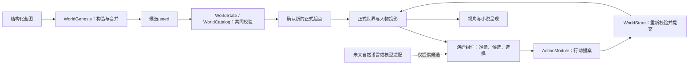

# 世界引擎的架构借鉴与当前对应

> 发布阅读说明：下文的本地历史报告位于忽略的 build 或 runs 目录，不随源码仓库上传。它们记录开发时的验证范围；运行对应脚本会生成你自己的新目录和报告。本轮复核见[开发版验证记录](RELEASE-CHECKS.md)。

核查日期：2026-10-11。本文面向继续实现和审查引擎的开发者，回答三个问题：已有机制借鉴了什么、落在哪个责任边界、还缺什么证据。它补充 [架构说明](ARCHITECTURE.md)、[协议](PROTOCOL.md) 和 [内核维护约定](KERNEL-MAINTENANCE.md)，不改变其中的公共合同。

## 1. 先确定要保留的核心

本项目当前是本地 Java 世界引擎：结构化蓝图构造起点，组件提出行动，内核校验并提交事件，历史派生当前状态和不同视图。共同年度时间与提交版本分别管理。准备草案、正式经历、人物认知、读者所见各有边界。

下面选择四个成熟机制作对照。**借鉴的是责任划分和失败处理，当前没有引入 LLVM、ServiceLoader、SQLite 或 Temporal。** 本文中的对应关系是我们根据官方资料作出的设计推导，不能据此宣称已经集成这些系统的全部能力。

这里有两个入口：构造起点与演绎后续变化。两者复用身份、引用、时间及声明法则的校验；后续变化还须通过版本、权限和整笔事务检查。草案校验通过后仍需确认，组件结果保存后仍可能没有正式事件。图中的模型和小说呈现只表示目标边界，当前未接入模型，也未验证小说阅读效果。

## 2. LLVM：先形成共同表示，再验证和执行

### 原机制

LLVM 前端教程把词法分析、解析和 AST、生成 IR 分为连续步骤；LLVM 的 IR 供后续阶段共同处理。官方语言参考还明确区分“语法能解析”与“表示合法”，由 verifier 检查后者。我们借鉴这种分工，让输入形式与执行规则之间有可检查的中间产物。[LLVM 前端教程](https://llvm.org/docs/tutorial/MyFirstLanguageFrontend/index.html)、[LLVM IR 与合法性校验](https://llvm.org/docs/LangRef.html#well-formedness)。

### 当前具体对应

| 责任 | 当前类与行为 | 能作出的结论 |
|---|---|---|
| 接受明确输入 | `Protocol` 检查 JSON 字段、类型、版本、重复键和数字表示。 | 能拒绝协议错误，不能理解一段自然语言的真实意图。 |
| 转为世界资料 | `WorldGenesis` 排列构造依赖、受控合并贡献，输出 `blueprint / seed / construction`。 | 各构造器共享标识和资料定义；不能各自建立另一份正式世界。 |
| 校验候选起点 | 构造结束调用 `new WorldState(seed)`，由 `WorldCatalog` 等检查引用、数量与声明法则。 | 构造入口复用内核规则；结构合法不等于地理来由、人物动机可信。 |
| 转为变化描述 | `ExperienceEngine` 约束已选行动，`ActionModule` 返回含身份、预期版本及 `effects` 的提案。 | 组件建议与正式变化分开；`resolve` 当前组织行动，并非通用物理裁决器。 |
| 解释受控效果 | `WorldState` 按已支持的效果类型应用变化；`WorldStore` 在候选副本通过整笔检查后保存事件。 | 支持协议内的效果解释，不支持任意脚本或任意叙事句子的执行。 |

`seed` 与 `proposal.effects` 可以视为本项目的两种领域中间表示：一个描述正式起点，一个描述后续事务。它们不是 LLVM IR，也不是两份互相竞争的权威状态。正式存档保留起点与事件，当前状态从它们派生；组件上下文只是快照。

### 借鉴边界与缺口

当前 JSON 约束主要由手写校验和效果分派表达，没有独立的 AST、完整类型系统、优化管线或代码生成器。不能把 LLVM verifier 的性质直接转移到本项目；人物是否有感情、行为是否自然、小说是否好读，也不属于协议合法性。

正式历史由当前内核重新解释。若以后改变某种效果的含义，仅保留 `schemaVersion: 1` 不能证明旧历史仍得到同样结果；需保留旧存档样本并明确兼容或迁移规则，不能静默改变过去。

以后增加自然语言入口时，它应产生带明确标识和未知项的候选蓝图、目标或提案，再进入同一校验口。不能把“模型说事情成功了”解释成已经提交；也不能把 `idea` 文本当成当前已实现的自然语言编译。

### 现有证据与待验证

- 本次源代码核对确认：构造依赖缺失或循环会拒绝；贡献只允许受控字段；重复贡献共同时间会拒绝；最终起点交给 `WorldState` 校验。确认入口重新构造并比对完整草案。
- `GenesisCheck`、`KernelCheck` 与 `TimeCheck` 提供对应正反例。已有运行结果按 [验收记录](ACCEPTANCE.md) 和 [共同时间案例](TIME-DEMO.md) 的具体范围读取；本次文档整理没有重新编译或执行它们。
- 新效果或新的输入前端仍需验证：非法引用、未知类型、错误时间和受保护事实必须在首次提交与历史恢复时一致拒绝；旧合法记录继续可读。当前没有从自然语言到正式事件的实测闭环。

## 3. Java ServiceLoader：实现可换，合同和宿主责任明确

### 原机制

Java 21 的 `ServiceLoader` 让应用通过一个服务接口发现、加载不同实现；宿主可检查实现提供的属性再作选择。接口与实现部署分离，服务定义仍需表达本领域需要的能力。我们采用这一组件边界思路，尚未采用它的发现和加载机制。[Java 21 ServiceLoader 官方合同](https://docs.oracle.com/en/java/javase/21/docs/api/java.base/java/util/ServiceLoader.html)。

### 当前具体对应

| 扩展合同 | 宿主负责什么 | 实现可以决定什么 |
|---|---|---|
| `WorldConstructor` | `WorldGenesis` 按 `id + version` 注册，冻结 `id/version/sectionName/dependencies`；只解析选中集合的资料与依赖，回调前后核查合同。 | 从对应结构化资料贡献人物、关系、资源等候选内容。 |
| `CreationInterceptor` | 宿主管理调用位置和独立上下文。 | 在构造前后检查或拒绝，不能通过回调直接覆盖共同资料。 |
| `ExperienceComponent` | `ExperienceEngine` 管五阶段顺序、捕获的 `id/version/stage`、记录和恢复；未完成回调前后核对身份。 | 准备、产生候选、选择、组织行动或解释实际反馈。 |
| `ActionModule` | `WorldStore` 按 `id + version` 注册、精准选择实现，提供行动者投影，核对提案身份、世界版本和事务。 | 在固定实现版本下提出一个已支持行动的候选效果。 |

当前注册是可信本地 Java 代码的显式 `register`。演绎请求固定每个阶段的组件标识和版本；上下文及 getter 返回深拷贝。相同合同下可以比较两种候选生成策略，共同的世界提交规则不随策略更换。

本轮把行为实现也纳入版本固定：`ActionModule.version()` 默认 `"1"`，同标识不同版本可并存。原行为方法始终选版本 1，显式重载选指定版本，不选最新。候选与转换结果可携带 `moduleVersion`，准备包和正式事件的 submission 保留该选择。旧记录缺字段解释为1，原形状不改写；等价比较不放宽完整 experience 请求归属。

阶段身份也在注册时捕获：未完成回调前后校验 `id/version/stage`，成功与失败记录保存捕获值；反馈的身份核对先于准备与正式提交。已完成阶段恢复仍需查到请求配置绑定，验证保存身份和产物后复用，跳过动态身份核查与回调；这不是缺少所有阶段实现也能恢复的合同。

本轮构造器也有版本合同：蓝图可用 `constructors:[{id,version}]` 选择，一次同标识只能选一版。选中集合的资料名称、支持section和依赖先完整检查，未注册精准版本、未选依赖、循环或section冲突在任何回调之前拒绝；未选版本不能干扰本次资料名称检查。构造及拦截回调前后核对冻结的四项合同，显式草案元数据取捕获值。

旧蓝图没有选择列表时，宿主每个已注册标识固定选版本1，原蓝图和草案不补写。只有新版实现而没有1时明确拒绝；新增注册标识导致旧管线输出改变时，确认完整比对也会拒绝。显式选择可以排除无关注册。当前 CLI 只有八个内置构造器版本1，其他实现仍由可信 Java 宿主注册，未增加自动发现或热加载。

信息边界也属于宿主责任。人物演绎只获取对应人物视图，不能因为换成模型实现就获取作者的全世界秘密。作者主动设置的资料和人物实际知道的资料仍分开；模型输出中的身份也不能替换本次请求的行动者。

### 借鉴边界与缺口

当前没有 `ServiceLoader` 自动发现、外部 JAR 插件配置、热替换或恶意代码隔离。深拷贝保护传入的数据对象，不是安全沙箱；可信 Java 实现仍在同一进程运行。

`ExperienceComponent`、`ActionModule` 与 `WorldConstructor` 已有各自的实现版本合同。正式历史恢复解释已保存的效果，不重新调用旧行为模块；已保存 prepared 可在缺少原实现时继续提交，但仍须核对选中行为、版本、完整输入和内核整笔事务。未保存准备结果且旧实现缺失时明确停止，不能改用新版。

构造确认与行为 prepared 恢复不同：`confirmSeed` 必须按原蓝图重新执行选中构造器，完整规范化草案相等才返回种子，不写文件、不修补旧草案。CLI 随后初始化只保存 seed 的正式起点，不复制草案 construction 元数据。新软件可读旧缺省格式，不承诺旧软件读取显式构造列表或新增元数据。

注册捕获扩展合同，回调前后检测身份或依赖变化；同版本源码不可被静默替换仍由维护纪律保证，版本号不是签名。实现版本固定也不证明跨内核软件的效果解释语义相同，旧存档重放仍须独立回归。不能据此声称所有扩展的版本兼容已经解决。

### 现有证据与待验证

- 本次接口与注册代码核对确认：重复 `id + version` 注册会拒绝，五阶段实现与请求配置匹配，阶段记录保留组件标识和版本，候选选择后行为模块、实现版本及参数不能被阶段输出替换。
- `GenesisCheck` 与 `ExperienceCheck` 有独立快照、拒绝回调、依赖及版本恢复的检查。现有证据覆盖本地受信实现，不覆盖第三方插件。
- 先前行为版本实测见 [行为版本案例](MODULE-VERSION-DEMO.md) 与 历史核对汇总（本地历史文件：`build/module-version-acceptance.json`）。本轮构造版本与完整确认有 Java 专项与独立命令行正反例，覆盖精准选择、选定依赖、合同漂移、快照、完整确认及旧草案兼容；十四套受影响结果见 本轮核对汇总（本地历史文件：`build/constructor-version-acceptance.json`）、[构造版本案例](CONSTRUCTOR-VERSION-DEMO.md) 和 [验收记录](ACCEPTANCE.md)。
- 下一次真实更换能力时，应保存旧版本并新增版本，验证旧过程继续恢复、新过程采用新实现、两个实现均不能改请求身份或直接写正式史。模型适配还需单独验证调用结果恢复，不能由接口存在推定已经接通。

## 4. SQLite：整笔事务与持久化失败分别处理

### 原机制

SQLite 的回滚日志提交协议用日志、锁及关键位置的落盘同步处理事务中断，使整笔变化表现为全部发生或全部不发生。其官方说明明确讨论操作系统缓冲、写入重排及断电。我们借鉴“提交要有可说明的失败边界”，没有在本项目使用 SQLite。[SQLite 原子提交机制](https://www.sqlite.org/atomiccommit.html)。

### 当前具体对应

`WorldStore` 当前的正式变化路径是：

1. 取得世界锁并加载合法历史，核对请求和预期版本。
2. 复制 `WorldState`，在候选上应用整笔效果；某个效果、权限、数量或法则不成立就拒绝。
3. 候选通过后，将完整事件附到待保存文档。
4. 写同目录临时文件，以 `ATOMIC_MOVE` 替换正式文件。不支持原子替换就报错。
5. 返回真实提交回执；同一请求再次提交时核对原输入并返回原回执，不能追加第二件事情。

长推导不持有世界文件锁：`propose` 在短锁内取得投影，释放锁后调用行为实现；`commitPrepared` 再次在锁内检查。推导期间发生新事件，旧候选不能靠旧快照绕过版本检查。

因此，时间推进与关系变化可以作为一笔事务一起接受或拒绝。它们不会因前几条效果在内存中已执行就成为半笔正式历史。

### 借鉴边界与缺口

当前持久层是 JSON 文件，没有 SQLite 的回滚日志、WAL 或等价的落盘协议；写临时文件与原子替换也没有显式 `fsync` / `FileChannel.force` 或目录同步。**文件替换的原子性不等于断电后的耐久性。** 现有机制不能被描述为已经具有 SQLite 的断电恢复保证。

正式世界文件、演绎记录、推进清单分别保存，不是跨文件原子事务。世界已提交而演绎记录尚未保存时，由原请求回执查询和恢复检查衔接，不能假定所有文件同时落盘。文件也没有签名，不能防止外部直接篡改后伪造合法历史。

### 现有证据与待验证

- 本次 `WorldStore` 源代码核对确认：候选副本、全事务校验、进程内及文件锁、同目录原子替换、请求去重和旧版本拒绝均有实际路径。
- `KernelCheck`、`ExperienceCheck` 及命令行检查覆盖整笔失败、并发版本、重复请求与原回执恢复等边界；这些检查的通过范围不包括断电实验。
- 若下一步要求更强持久性，应先确定“进程退出、操作系统崩溃、断电”各自验收范围，再用受控故障注入验证。选择补充文件落盘协议还是换事务存储，属于后续实现选择；本文不把选择或计划计入当前能力。

## 5. Temporal：保存执行经过，恢复时尊重已经发生的结果

### 原机制

Temporal 将执行产生的命令与已有事件历史对应；重放检查两者一致，并从已经记录的进度继续。我们借鉴保存经过和恢复一致性的思路，而非每次失败后从头重新推导或重复外部效果。[Temporal 执行与重放机制](https://docs.temporal.io/workflow-execution#replays)。

### 当前具体对应

| 记录 | 当前用途 | 恢复依据 |
|---|---|---|
| 正式世界事件 | `WorldStore` 从起点按序解释已提交效果。 | 连续版本、唯一请求、合法提案和事件共同时间；不重新调用行为实现。 |
| 五阶段记录 | `ExperienceEngine` 保存阶段结果、组件版本、已选行为版本、准备记录和回执。 | 完整原请求、阶段顺序及版本匹配，完成的阶段恢复已有输出。 |
| 实际反馈 | 提交后使用 `viewAt(receipt.revision)` 形成反馈。 | 绑定那次真实结果，不能拿之后的世界状态冒充当时所见。 |
| 逐步推进清单 | `GoalJourney` 绑定完整目标输入、步骤与预算。 | 后续预期版本来自上一真实回执；同目录同输入续跑，预算耗尽为暂停。 |

执行记录与正式历史各有用途。一个阶段完成、一次缺口停止或一次目标满足，均不必产生世界事件；正式提交才改变世界。失败在提交之前与提交之后分开处理，恢复先查已经发生的结果。已完成过程重跑不能重复落账。

行为 submission 增加可选版本字段，缺字段明确定义为1。旧调用和显式1可以查询同一完整输入的权威回执，版本2复用版本1的请求标识会拒绝。恢复已有 prepared 不重新推导；既无准备结果也无正式结果且原实现缺失时，过程停止。`schemaVersion` 保持1表示这项可选扩充，新软件读取旧记录的兼容方向已定义，不承诺旧软件读取新显式字段。

### 借鉴边界与缺口

本项目没有 Temporal SDK、服务端、分布式工作者、持久计时器或它的命令确定性重放系统。当前是本地阶段输出恢复，加正式事件重放；不是把任意 Java 回调变成可重放工作流。

回调已运行但结果尚未保存，恢复仍可能再次调用。正式提交去重不等于远程模型或付费调用恰好执行一次；未来模型接入必须另建调用身份、结果查询与保存策略。相同组件版本也不能掩盖代码已换的事实，跨版本恢复需要兼容检查和回归。

### 现有证据与待验证

- 本次源代码核对确认：原请求与组件版本固定，阶段历史检查，原提交回执恢复，反馈绑定原历史视图，目标过程独立保存和预算续跑均已编码。
- `ExperienceCheck` 与 `TimeCheck` 的现有受控实验已覆盖提交后回执保存窗口、反馈失败及阶段保存窗口的恢复，并核对不重复提交和原历史视图；本轮运行结果见 [验收记录](ACCEPTANCE.md)。这些是已经取得的局部证据。
- [目标案例](GOAL-REVISION.md) 的现有实测资料包含“询问、移动、观察、满足”，前三步产生正式事件，满足记录不产生事件；原过程恢复没有增加事件。该结果只证明这组结构化目标及恢复合同。
- 待验证的是这些已测位置之外的中断组合、跨软件版本、断电及远程调用恢复，不能由局部受控窗口推定任意故障都可恢复。模型接入和小说质量仍未验证。

## 6. 将借鉴落实为后续修改的判断

四种对照共同支持一条运行纪律：**扩展负责提出候选，内核负责最后校验和正式提交；已经发生的结果成为下一轮依据。** 这条纪律已经体现在现有入口和记录中，不能因新模型、新题材或新界面而绕过。

维护方式还沿用 [内核维护约定](KERNEL-MAINTENANCE.md) 的依据：Linux 官方说明区分对用户的稳定接口与可演进的内部接口，内部接口改变时同步修正使用者。我们的设计推导是保持共同约束和存档含义，允许内部实现改善，但同时调整受影响组件、检查旧历史并回归；并非冻结所有内部接口，也不表示本项目拥有 Linux 的架构或可靠性。[Linux 内部接口维护说明](https://docs.kernel.org/process/stable-api-nonsense.html)。

后续新增能力按以下次序进入现有引擎：

1. 明确它读哪种视图，输出草案、行动候选还是呈现文字；未知项保留未知。
2. 用当前合同先运行一件具体小事，记录它需要和实际取得的依据。
3. 只有现有效果确实无法表达结果时，才扩展协议、校验和历史解释；同时处理旧记录兼容。
4. 验证一次有效结果，再验证错误资料、重复请求和中断恢复；不以生成了一段文字替代提交证据。
5. 单独评读人物交流、情绪、详略和衔接。结构与恢复检查不能替代作品评价。

例如，阿禾“想把铁料送回去”首先是意图。本人未知箱子在哪时可以尝试询问；知道下落后仍需要走法；抵达后还要现场观察。知道箱子在货栈，不等于有权领取、具备工具或已经运回铁铺。组件可把这些缺口和下一步候选组织出来，内核只能接受已有协议和依据支持的变化，小说呈现也须遵守这一结果。

当前需要继续验证的集中在四处：领域表示与新效果的兼容、不同实现的版本恢复、文件耐久和跨记录恢复、模型候选及正文的实际质量。共同时间、信息隔离、历史与权限继续有效；借鉴成熟系统的设计不能代替这些本项目的实验，也不能保证今后不会出现重大缺陷。

## 7. 本次交付的证据范围

本文初次整理读取实现、协议及维护文档，并核查上述官方一手资料；本轮更新构造版本与完整确认的对应关系，沿用原有来源，没有新增未读来源。这次文档修改没有修改生产代码、增加框架依赖、执行共享编译或调用模型。当前运行结论来自重新读取十四套原始报告、各逐项结果、进程 stdout/stderr 与独立退出码，来源及文件摘要保存在 本轮汇总（本地历史文件：`build/constructor-version-acceptance.json`）。保留的内核红报告（本地历史文件：`build/kernel-audit-before-fix.json`）记录两项修正前失败，本轮对应项均通过。历史案例仍按各自记录范围阅读；这些结果不证明风格正文或尚未验证的准备缺口分析。
