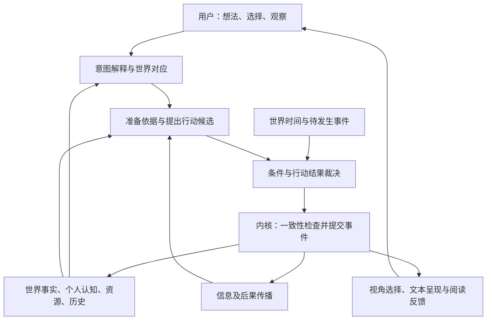
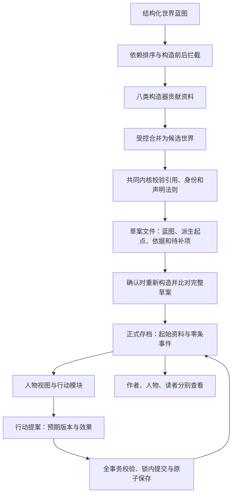
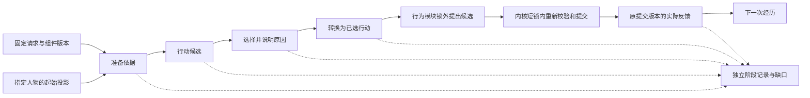

# 创世界引擎架构与 0.1 实现

> 发布阅读说明：下文的本地历史报告位于忽略的 build 或 runs 目录，不随源码仓库上传。它们记录开发时的验证范围；运行对应脚本会生成你自己的新目录和报告。本轮复核见[开发版验证记录](RELEASE-CHECKS.md)。

## 一、我们要解决的问题

创作者提供想法并作出有意义的选择；系统补齐难以处理的准备和推导，让人物依据经历、认知和处境行动，让行动影响世界。相同的世界可以被不同视角观察，并形成可阅读的小说或文字互动体验。

可以把它描述为：**以持续世界为基础、以事件为共同语言、以人物选择为动力的创作内核。** 用户从一座城、几个核心人物或一个事件开始，系统逐步展开相关范围。未展开区域不是每次都重新生成的空白背景；新资料需要与已有世界对应。

经典编译器、组件加载、事务提交与执行恢复的机制，如何对应当前实现，见 [架构借鉴与当前对应](ARCHITECTURE-REFERENCES.md)。该对照保留采用范围、实际证据与缺口，不把引用成熟系统当成已经获得其可靠性。

世界不是每次生成文字时重新编造的背景。地理、历史、资源、制度、人物和生态形成持续存在的状态。已发生的事情属于历史；砍树、加工铁矿、移动、出生等变化需要新的事件与依据。

空间、共同时间、关系历史与按需展开约束，集中在 [持续世界的内核合同](WORLD-KERNEL-CONTRACTS.md)。其中共同年度时间、出生年派生年龄、带年份的关系变化与历史查询已经编码；本轮实测见 [共同时间小闭环](TIME-DEMO.md)。细分日历、生活调度和按需展开仍是设计候选，不能计入已运行能力。

### 写正文之前，引擎需要完成什么

创作者可能先积累大量资料、形成世界画面、反复推敲人物生活与可能经历，再开始第一章。也可能从一个小世界与短篇试写逐渐扩展。准备成果应能独立保存、关联和复用，不以是否已经生成章节衡量价值；同时，资料多并不自动证明准备得好。

引擎需要帮助创作者形成“心里有这个世界”的状态：知道一个地方为什么存在、谁怎样生活、各自为什么想做某件事、相遇后可能怎样回应。小说从这些内容中选择值得呈现的经历。世界资料可以丰富，正文保留取舍与读者联想的空间。准备中也可以写短试样检验人物与氛围，但需标明所用草案或预演版本，不能因为写成了文字就自动成为正式历史。

下面是完整准备生命周期。0.1已编码结构化草案构造、首次保存、确认正式起点，以及按声明要求对照草案或正式世界的只读准备分析；自动推导准备要求和独立预演管理仍按目标架构说明：

| 阶段 | 应保留的成果 | 与正式世界的边界 |
|---|---|---|
| 资料积累 | 来源、版本、有关内容、提炼结论及未知项；区分作者要求、作品资料、调查材料与原创设想。 | 来源材料不能自动成为本世界事实；借鉴方法保留适用条件，不锁死人物与情节。 |
| 世界草案 | 地点、生活条件、制度、人物、经历、关系与当前处境的关联，以及选择这些设定的依据。 | 尚未确认的设定可以比较和修订；草案版本改变时，标明哪些预演需要重做。 |
| 预演实例 | 所用草案版本、起始状态、刺激、人物获知过程、候选行动、结果及发现的问题。 | 每次预演使用独立身份与历史，不能向正式存档提交；成功的一条分支仍是可能性。 |
| 正式世界 | 确认后的起始设定与此后真正发生的事件。 | 起点建立后遵守事实与历史保护；当前状态通过新事件变化。 |
| 小说呈现 | 引用的世界与事件版本、视角、读者获知顺序、正文及修改依据。 | 组织与修订表达，不能为配合文字改写正式事实。 |

资料、草案和预演可以共享数据定义、校验及模块能力，但不共享可写的正式历史。每个实例内部只有一份权威世界；正式世界建立时选取已确认的起始资料，不把预演事件整体合并过去。

时间含义也必须明确：起点之前的背景经历属于确认的背景史；未来愿望属于设想；约定将来发生的事情属于带条件的安排；预演中发生的事情只属于该次预演。它们都不能冒充正式运行刚刚发生的事件。

### 怎样判断准备已经有用

就绪判断针对下一段打算演绎的经历，例如三个人在一个上午寻找一箱铁料。无需先穷尽整片大陆，也不规定必须规划多少章。系统根据这段经历需要的依据选择补充资料：

1. **环境能支撑生活。** 相关地点、连接、资源、制度与生活方式能解释人物为何在这里；不用只剩地名和形容词。
2. **人物在事件之前已经成立。** 经历、职责、关系和顾虑能解释当前意图；不要求把将来的情绪和选择提前定死。
3. **人物获知事情有途径。** 明确观察或转述来自谁、何处、何时；人物可以误解，但不能凭空知道未来或秘密。
4. **行动有可检验条件。** 与当前结果有关的权限、资源、通路和对方回应要能说明；愿望不充当成功依据。
5. **未知项有范围。** 影响当前行动或裁决的缺口先补，或缩小演绎范围；暂时无关的地域和历史可以保留未展开状态。

准备输出应列出已经建立的关联、仍缺的依据、可试的方案和下一段经历的范围。进度以这些内容是否能支撑人物生活与行动衡量，不以字数、字段填满率或笼统分数衡量。

预演的反馈要能定位：缺了哪项世界依据、哪次消息没有送达、哪处人物选择显得生硬、哪段呈现重复解释。事实缺口补草案，机制错误修执行环节，表达问题修正文；保留已经有效的部分。事实校验通过不能替代人物与阅读效果的评读。

### 河港镇的准备审查示例

以下是对现有 `examples/river-town.json` 的人工审查与下一步设计，不是已经运行的自动准备器，也没有改动示例世界。

| 要演绎的内容 | 当前资料依据 | 还需要什么 |
|---|---|---|
| 阿禾寻找铁料 | 铁铺学徒；担心误送；清晨码头原处没了货箱。 | 此次委托、货物归属和交接责任尚不明确；不妨碍先查下落，但领取或搬运前需要补清，不能直接认定林桂就是委托人或师父。 |
| 阿禾询问陈舟 | 两人在南码头；曾在交接时见过；陈舟知道货箱在货栈。 | 人物视角可以使用其听闻；陈舟最初怎样得到消息尚需铺垫，不能把初始认识冒充引擎观察到的过程。 |
| 阿禾前往货栈 | 已有南码头到货栈的有向通路；货箱位置可在货栈观察。 | 客观通路不等于阿禾熟悉走法；先取得地点线索与走法依据。移动不等于已完成观察；搬运另需交接、工具、人力与时间条件。 |
| 林桂等铁料、陈舟急着交接 | 林桂今日交货需要铁料；陈舟家中有人生病。 | 两人的当前生活与顾虑可以支撑回应；阿禾若没获知这些私事，不能用它们直接作判断。 |
| 人物形成合作或误会 | 当前仅有阿禾与陈舟的少量交接关系记录。 | 合作、信任或责怪应从实际对话与行为发展，不能因为作者想要结局就预先写成关系事实。 |

第一段预演可先限定为“询问、沿路抵达、观察、决定下一步”。希望最终按时送到铁铺可以保留为方向；当前资料不足以证明运输成功。先把这一局部成立，再决定是否展开运输、等货人物的反应与更多世界背景。

对同一草案至少保留以下针对性反例，结果与具体依据一起记录：

- 去掉传话或观察，未获知人物不能照旧因该消息作出反应。
- 去掉搬运条件，不能仍然直接得到货箱已送达的成功结局。
- 改变某个人的顾虑，允许比较其选择是否有区别，不能只替换情绪标签而保留全部动作。
- 改变草案中的交接责任，原来依赖该责任的预演需要重新检查。
- 预演已经合作成功，正式起点仍不能凭此声称他们已经合作过。

这些反例能检查准备与演绎的衔接，不能独立证明小说质量。0.1可以构造并首次保存草案、核对蓝图后确认起点；本轮另加了人物视图中的声明依据检查，未自动推导一件事需要哪些依据。尚无资料库、草案版本管理、依赖失效或预演实例管理。新构造示例另见 `examples/genesis-river-town.json`，其中师徒关系是明确新增的作者设定，不能反向当作原示例已有依据。

本轮代码先落实声明依据、候选选择、行动提交与实际反馈；声明不足时记录缺口，不能继续提交。下一层仍需按经历自动推导准备要求，在独立预演实例中运行行动，以及修订草案后标记受影响的预演。现有确认操作重新运行构造并比对完整草案，再建立新的正式存档；它尚不证明下一段经历所需的依据已经充分。模型可作为未来构造、推导和评读的组件，版本检查、实例隔离和正式提交继续由程序统一控制。

这一闭环的验收应同时包含正反例：缺少搬运条件时可以继续询问，却不能宣布运输成功；修订草案不改变旧正式存档；预演成功不自动复制为正式经历；重新加载后能找回原资料、方案和修订理由。通过后再接更多创造模块，避免模块很多却没有贯通的准备过程。

### 世界怎样逐步构造

从用户提供的一座城或一个人物起点，构造层逐步建立下列相互引用的资料，而不是机械填完全部选项：

1. **空间与来由：**地点位置、连接、地形、资源、形成经过。建筑、城镇、地区的资料属于同一布局。
2. **生活与文化：**生计、物资、风土、人文、日常规范及其依据。人物可以有不同偏好和理解，但客观地点不随观察者重新生成。
3. **制度与势力：**军队、宗门、商人和居民的资源、权力、义务、利益与依赖。强势和弱势者都有各自目的。
4. **核心人物：**外貌、衣着、年龄等形象资料，以及经历、品性、欲望、顾虑、能力和认识。资料存储可以丰富，给模型时只取当前用途相关部分。
5. **关系与共同经历：**亲情、利益、恩怨、承诺和情感羁绊，记录谁怎样理解对方。关系由有来源的经历影响选择。
6. **当前生活与待办：**人物正在做什么、要去哪里、受何种限制、可能遇见谁。事件不是为了目标硬塞，而是从这些条件推导。
7. **演绎与反馈：**候选行动被裁决，后果改变资源、处境或认识，形成下一轮依据。场景体验经试读后修订推导和呈现方法。

这是构造层的目标方法。0.1已由八类构造器把作者明确提供的JSON蓝图编为相互引用的草案，并复用正式内核校验；尚不从一句想法自动推导这些资料，也不核实说明文字的真实因果。引用已有作品的世界时需要有来源的材料和版本，不能把未核实的设定当作原作事实；原创世界则需要构造和试演验证。

小说层放在这些持续状态与事件之后，使用记录选取视角、铺垫、详略和对话。真实运行过一个小世界不等于已经证明小说写得好，两项需要分别验收。

### 风格约束的位置（尚未实现）

风格模块的第一版建议包含十项共用约束：题材体验、叙述视角、语言语气、节奏详略、场景呈现、对话组织、人物声音、情感表达、信息揭示、段章承接；拟用玄幻成长、悬疑、经营、日常情感四类模板试验。它作用于场景编排、正文生成和回读，读取同一世界及允许使用的事件视图；替换风格仍须保持正式事实、人物知识和信息来源。人物说话由关系、处境、经历与当前目的提供依据，风格决定这些内容如何呈现。配置和实现可固定版本后比较替换。

验收应使用同一段事件与人物投影，比较不同风格的详略、语气与对话效果，并核对没有新增世界事实、泄漏人物未知或改变已提交后果；再用连续正文检验人物交流和阅读体验。上述清单及模板属于建议范围，尚待正文验证。当前尚未实现风格配置、场景编排及正文生成/回读接口，本段不增加已支持的 JSON 字段或能力声明。

## 二、原则与责任

1. **事实统一，历史向前。** 稳定人物标识与固定设定不可改写；职务等当前状态允许有因由的变化。
2. **意图、尝试与结果分开。** 用户希望两人合作，不代表两人已经同意。人物申请借船，不代表船已经借到。
3. **认知有来源。** 真相、观察、转述、推测和读者所见分开；新证据改变认识，旧误解留下历史。
4. **约束主要来自数据。** 地理、人物经历和资源作为世界资料；模型结合资料推导。程序实现少量共同机制，不为每个性格或每座城编写专属条件分支。
5. **变化由内核提交。** 能力模块提出建议，校验、裁决和记录共同管理。生成正文不能自行改事实。
6. **扩展用实际试验证明。** 新能力应能读旧存档、继续新事件；失败不能破坏过去。功能测试与人物自然、作品好读的评价分别报告。
7. **准备可迭代，正式历史不倒写。** 草案与预演先充分比较，确认后建立正式起点；未来设想不能变成已经发生的历史。

## 三、完整运行循环（目标架构）

“解释”先识别用户在设定、行动、观察还是提出愿望，再对应人物、地点、时刻和已确定条件。未知内容作为待补资料或候选，不直接升级为事实。

模型推导意图和情绪时使用当前人物资料；作者规划可使用完整资料；叙述使用允许揭示的资料。不是让所有模型调用都获得全部秘密。

### 模块怎样共同演绎

模块输出应说明本次建议依据哪些事实或观察、有哪些条件、建议发生什么、预期影响谁。内核排列可执行的动作，裁决资源与版本冲突，记录结果后再通知受影响模块。未成立的建议保持候选状态。

情绪、欲望、关系、记忆可作为不同判断能力，但应共同作用于同一份人物状态。不能让“贪欲模块”“心情模块”“关系模块”各自维护另一套人物并直接命令其行动。它们帮助理解这件事对人物意味着什么，再由人物行动推导综合出选择。

事件触发来源包括人物行动、时间到达、环境变化和此前安排，不局限于某个人主动触发。第一版尚无统一调度器；这项架构需要用延迟通告、争用资源和人物反应的连贯试验检验。

## 四、0.1 已编码的最小结构

当前收敛为以下**五个职责**，共用一份正式世界。八类构造器、只读准备分析和五阶段编排均有实际实现，处理的是结构化输入与声明策略；自动补全世界、人物持续决策与情感演变属于后续能力。

| 职责 | 权威输入与输出 | 当前边界 |
|---|---|---|
| 世界权威内核 | `WorldStore/WorldState/WorldCatalog/WorldTime` 从 seed 与正式事件重建状态，输出历史、分受众视图和回执。 | 只有共同提交器能追加正式事件；派生状态与投影不是另一份存档。 |
| 世界构造 | `WorldGenesis` 按蓝图与选定构造器版本生成草案，完整确认后返回可初始化的 seed。 | 面向新起点；草案、贡献说明和预演不能进入既有正式历史。 |
| 准备诊断 | `WorldPreparation` 对照同一版本的作者和本人视图，输出各自可见的声明条件报告。 | 只读，检查范围由要求清单声明；`ready` 不等于资料完备、许可或行动成功。 |
| 能力组件 | 行动模块及五阶段组件接收独立快照，提出候选或提案；反馈引用真实回执。 | 实现可以按版本替换，不能自行改写世界；人物行动只使用本人可见依据。 |
| 共同宿主与驱动 | `WorldEngine` 装配构造、准备、演绎和行为注册；`ExperienceEngine/GoalJourney` 保存过程并恢复；CLI 转换输入输出。 | 宿主不另存世界状态，驱动不能代替正式提交，预算和阶段记录不是正式历史。 |

### 八类构造器怎样协作

| 构造器 | 实际贡献 | 协作依据与边界 |
|---|---|---|
| 世界 | 地点、通路、事实、地区与资源目录。 | 建立其余模块引用的环境；地理与来由来自蓝图，未自动生成地图坐标。 |
| 人物 | 身份、当前位置、公开形象和私有资料。 | 人物引用已建立地点；不按年龄或性格标签推断未提供的经历。 |
| 势力 | 势力目录、属性和与人物或地点的引用。 | 规章说明可以保留，尚不自动转为权限判定。 |
| 群体 | 群体目录和总人数事实引用。 | 依赖世界、人物与势力；总人数只从同一个状态事实读取。 |
| 龙套 | 具体人物及其群体成员登记。 | 依赖群体与人物；展开数量不能超过群体总人数。 |
| 关系 | 双方关系及可选依据，正式起点也保留依据。 | 可引用核心人物和龙套；关系按方向记录，不自动推导对方的看法。 |
| 情感 | 本人私有的初始感受和触发说明。 | 可引用核心人物和龙套；不泄漏给他人，也不声称已经推导了心理。 |
| 法则 | 数值范围、允许值、声明的状态写入权限与变化前提。 | 起点检查声明和引用，变化前提在正式提交与重放时按提交前事实检查；不从势力职务或规章文字推断权限。 |

依赖缺失或循环在构造执行前拒绝。可选资料未提供时，模块保留说明，不补造设定。构造器仅贡献允许的数组或增补项；人物私有资料不能覆盖已有字段。上下文与拦截回调接收独立快照，失败可以否决候选。最终候选再次交给正式内核校验，不另写一套初始世界规则。这里的扩展是可信本地Java代码，尚无外部插件加载或恶意代码隔离。

构造器按 `id + version` 注册，默认版本1，同标识不同版本可并存。蓝图可选 `constructors:[{id,version}]` 固定本次集合，同标识只选一版；只在选中集合中校验资料名称和依赖。精准版本未注册、依赖未选、循环及section冲突在所有回调之前拒绝。`sections.world` 仍必填，处理器的标识可以是其他名称。旧蓝图固定选择宿主每个已注册标识的版本1，不选最新、不补写旧蓝图或草案形状。

注册冻结 `id/version/sectionName/dependencies`，依赖集合不可变；构造回调与每个拦截回调前后核对全部选中合同。显式管线的贡献记录增加版本、section、依赖元数据，依据行增加 `moduleVersion`，均取捕获值。默认八类构造器不变，当前 CLI 只注册它们的版本1，自定义实现须在 Java 宿主注册。版本标识不提供源码签名，同版语义不可变仍依赖维护纪律。

`WorldGenesis.confirmSeed` 按草案原蓝图重建，完整规范化内容相等才返回 seed 深拷贝，不写文件或修补草案。CLI 随后初始化新正式世界，只保存 seed，不复制草案 construction 元数据或预演历史。旧缺省蓝图可能因新增注册标识产生不同重建结果，此时明确拒绝；新显式列表可排除无关注册。本轮专项与独立命令行已核对精准选择、回调前预检、合同漂移、旧草案兼容、完整确认和确认后行动，受影响十四套结果见 本轮核对汇总（本地历史文件：`build/constructor-version-acceptance.json`）、[构造版本案例](CONSTRUCTOR-VERSION-DEMO.md) 和 [验收记录](ACCEPTANCE.md)。

### 内核的共同责任

- **共同身份与引用。** 地点、人物和目录实体不能重名冒用；目录引用必须存在。
- **同一份数量。** 资源数量引用事实，群体人数引用非负整数状态事实，不能小于已登记的具体成员数。
- **同一套声明法则。** 初始化检查声明与引用，正式事务和历史恢复使用同一内核执行数值范围、允许值、状态写入边界与变化前提；起点合法不等于已验证身份取得过程，也不是完整物理、生态或社会权力系统。
- **历史与当前状态。** 固定设定不可改写；可变状态用新事件更新，旧听闻与历史保留。
- **共同年度时间。** 时间与提交版本分别管理；出生年派生年龄，旧人物描述带快照年份，知识区分获知年和证据年。时间效果和其他后果一起提交或一起拒绝。
- **信息范围。** 全目录属于作者资料；人物只获取对应视图，读者只获取明确揭示的资料。
- **提交与恢复。** 版本冲突、重复请求、事务失败和文件保存由同一个存档层处理。

草案可以另存新候选。确认操作不覆盖旧正式世界、不把预演历史合并为正式事件。实体定义与法则仍固定于初始资料；已有作者追加地点、通路、人物与事实的事件，群体成员引用另可通过 `group.member.add` 增量登记。新群体人物须在同一事务中 `person.add` 后登记，归属与总人数约束在事务结束时统一检查；总人数不会因展开一个成员自动增加，失败不修改 seed 或正式历史。整目录增量、运行期法则变更、绑定既有世界版本与时间的构造增量，以及条件激活仍未实现。

| 类 | 当前职责 |
|---|---|
| WorldCli | 将命令行输入转换为 JSON 操作，输出结果或错误。 |
| WorldEngine | 持有共同构造、准备、演绎实例与行为注册，打开世界时装配同一宿主的行为，向连续过程传入已注册演绎引擎。 |
| Protocol | 校验字段、类型和版本，规范数字与对象表示。 |
| WorldGenesis | 解析结构化蓝图，按固定版本集合排列依赖，受控合并贡献；完整重建比对草案后返回可初始化种子。 |
| WorldConstructor | 声明标识、版本、资料名称与依赖；宿主捕获四项合同，回调接收独立上下文并返回贡献。 |
| CreationInterceptor | 构造前后检查并拒绝候选；回调不能直接改写共同快照。 |
| WorldCatalog | 地区、资源、势力、群体与法则的定义和引用校验；检查声明写权限和提交前变化条件，按事件登记群体成员。 |
| WorldState | 保留由存档推导的状态，校验效果，生成作者、人物、读者视图；候选复制隔离目录及其他可变数据。 |
| WorldTime | 年度时钟唯一格式与单调推进校验，复制时隔离候选时间，核对历史事件记录时间。 |
| WorldStore | 锁定、重放、原子保存、重复请求处理；按标识与实现版本注册行为模块，精准推导并核对提交。 |
| ActionModule | 声明标识与实现版本，接收指定行动者的视图和输入，返回身份保持一致的行动提案；内置询问、移动与观察只支持人物身份。 |
| BuiltinModules | 询问、移动和现场观察三个确定性行为例子；观察复用已有知识变化规则。 |
| WorldPreparation | 在同一历史版本分别对照作者事实与本人认识，只读输出声明要求及缺口。 |
| ExperienceComponent | 准备、候选、选择、行动转换、反馈五阶段合同；所有上下文为独立快照。 |
| BuiltinExperienceComponents | 人物视图中的声明依据检查、候选筛选、整数优先级选择、已选行动转换与实际反馈。 |
| ExperienceEngine | 捕获阶段标识、版本和阶段，回调前后核对；保存独立阶段记录，恢复失败阶段，核对已选行动与正式回执；通过 WorldStore 提交。 |
| KnowledgeGoalComponents | 给定结构化观察目标，从本人认识和已知路径生成下一步，实际反馈仍来自内核。 |
| MessageReactionComponents | 核对本人收到的消息与明确回应策略，从本人知识筛选候选；复用已有五阶段选择、转换、反馈与版本恢复。 |
| MessageResponseModule | 执行前再次核对同一消息和规则，仅提出主动转述及本人方向的关系变化，由共同内核裁决。 |
| MessageStateResponseModule | 从本人明确消息和策略中选择一项状态决定，提出关联状态变化、本人现场核对及分享；身份资格、旧值和观察条件仍由共同内核裁决。 |
| GoalJourney | 使用传入的演绎引擎，独立保存连续步骤，每次提交后重判目标，支持累计预算暂停、续接和完成核对。 |

源代码按责任分离，仍是一个项目、一个进程。现在不是操作系统，也尚未成为完整的人物心理或物理模拟器。

### 共同装配与扩展入口

`WorldEngine` 的 `register` 分别接收构造器、五阶段组件和行为模块，仍由原注册器检查标识及版本；`genesis()/preparation()/experience()` 返回本宿主持有的实例。`openWorld(path)` 新建并装配该宿主已注册的行为，不创建或修改世界文件。调用 `pursue` 时把同一个演绎实例传入 `GoalJourney`，每步保持请求指定的组件版本与已选行动版本，不重新创建默认引擎替代它。

调用方应将 `engine.openWorld(...)` 返回的 store 传给该宿主的演绎与连续过程；`pursue` 不会向任意外部 store 自动补装行为。原 `GoalJourney.run(world, request, directory, maxAttempts)` 保留默认引擎语义，新重载允许显式传入引擎。CLI 统一经共同宿主调用现有能力；每次启动仍使用内置注册，没有外部插件、注册配置持久化或运行中热替换。

### 状态写入边界与社会权力

`writeAccess` 在一个可变事实上声明哪些既有人物能提交 `fact.change`，同一事实只允许一条写权限法则，作者保留明确的作者操作权限。直接提案、行为准备包、正式提交和历史回放都经过同一效果检查。未声明权限的旧事实保留原语义，不能把这种兼容方式称为已经具有业务授权；新小世界应为关键状态明确声明边界。

这只是底层写入边界。社会权力需要明确支配对象、决定范围、执行条件与人物反应，把决定、获知、回应和执行后果记成可区分的事实与事件。现有目录、事实、关系、知识和事件可以承载作者明确提供的部分资料，但职务到权力范围的通用映射与资源分配校验尚未实现；职务文字和 `reason` 不自动执行这些约束。本轮不增加独立政治或心理系统。

`changeRequires` 补充一项通用的执行前提：目标状态发生声明变化时，按整笔提交开始的权威事实核对条件；可再以行动者的 `subject + predicate` 对应事实检查身份值。它与 `writeAccess` 同时适用，作者也不能免除前提。未知值不能满足条件，同笔提案先授予身份或先补条件再使用也不能通过。该检查不读取人物听闻作为真值，不按人名或地点名写专用分支。

这些是行动开始的条件，不是以后每一刻必须维持的不变量。全部前提先检查，再在候选状态上执行整笔效果；任一效果失败不落账。本轮受控身份槽及法则须在起点声明，当前没有运行期追加法则或自动生成身份约束的能力。精确字段见[协议](PROTOCOL.md)。

### 上帝之手：创作者直接确定起点与方向

创作者可以直接设定“此人是村长”“此人经营铁铺”、已有势力格局、主角成长环境和故事方向。这些是世界起点的依据，不要求先模拟文明发展、历任身份取得或权力竞争。起点只检查已声明资料的结构、引用和适用的状态法则，不运行授予事件，也不声称验证了身份取得过程；后来变更预先声明的身份槽则须通过当下事件与变化前提。

世界机制中性呈现复杂人性，允许私心、分歧和阻碍，不按道德评价改写事实。作者可以拨动事件与叙事方向，使善良朴素、追求美好生活的人有机会实现目标，通过人物选择、努力及亲友支持显出希望。创作体验以快乐成长、合作与美好生活为目标，不要求人人顺利，也不默认以放大苦难、歌颂贫穷或过度揭丑推进。

没有达到目标不等于人物没有价值，也不构成只能成为龙套的世界规则。主角的重要性与叙事焦点、因果贡献和经历的展开有关；普通人的互助与尊严同样值得保留。这些是作者方向与呈现取舍，不是内核中的价值评分或角色分配法则。文学效果仍须用实际正文评读，不能只靠配置宣称成立。

“上帝之手”是创作控制的设计约定：草案阶段调整设定，正式运行阶段安排有时间依据的事件、指定目标和调整编排节奏。正式干预仍记录作者身份及发生时刻，当前变化与旧历史分别保留；角色不会因作者干预自动知情。现有构造、作者提案和目标入口能承载结构化的部分操作，尚无一句话控制世界的解释器，也没有自动把村长或国王等角色模板转成完整行为规则。它复用共同世界和历史，不另建一个权威状态。

人物标识与故事身份分开。已确定但未揭示的身份按人物与读者的信息范围展开；后来的职务变化通过可变状态与当前事件记录。作者可明确补充尚未定义的背景，但本轮受控身份槽与法则须预先声明，不把任意晚补身份说成已有通用约束。已有身份事实不能借换一个标识重复定义同一逻辑事实，已发生经历也不因补充身份而回填重写。赋予身份不会自动更新他人认识或读者所见。当前能够保存身份依据并检查结构化条件，非空 `reason` 与作者确认的条件值不证明自然语言内容真实或身份语义吻合；完整身份模板、心理推导与模型解释仍未实现。

### 本轮演绎怎样降低耦合

同一组件接口覆盖五个用途；每次请求明确一个版本组合。替换准备或选择组件不需要改正式事实和历史协议。各阶段只拿自己的上下文副本，不能通过修改输入影响下一阶段。编排器核对候选存在、转换没有偷换行动，行为模块的提案再由共同提交器检查身份、版本和效果。

行为模块现在按 `ActionModule.id + version` 注册；`version()` 默认文本 `"1"`，重复组合拒绝，同标识新版本可并存。原 `step/propose/receiptFor(module,input)` 固定使用1，新增带 `moduleVersion` 的重载精准选择，不选最新。候选、行动转换、prepared submission 和正式事件须绑定同一行为版本及完整输入；完整 experience 请求归属继续严格比较。版本必须非空且不含 CR/LF。

阶段实现注册时捕获 `id/version/stage`，未完成回调前后核对身份，成功与失败记录保存捕获值。反馈身份在准备及正式提交前检查，避免漂移实现先产生正式效果。已完成阶段恢复仍要求找到配置绑定并验证保存产物，随后复用结果而不执行回调或动态身份核查；它不允许缺少全部阶段实现。

WorldStore 在入口冻结行为输入。读取投影和检查已有请求使用短文件锁，推导在锁外，提交再加锁核对。演绎记录可串行保存，但不会持有正式世界锁等待推导。提交期间其他人已经推进世界时，旧候选明确拒绝，不默默改成新版本。

每个阶段保存结果后再推进；缺口停止由阶段历史恢复。已提交而反馈失败时只补反馈，使用 `viewAt(actor, receipt.revision)`，不会把之后的事件混入原结果。完成记录回读只查询权威回执与历史投影；无效回执不能在拒绝前首次提交事件。阶段缓存防止已经保存的部分重做，尚未保存的回调可能重试，不能据此声称未来模型恰好调用一次。

已保存 prepared 可以在没有原行为模块的宿主恢复，通过已有提交器重新检查身份、世界版本、权限和整笔效果；已正式事件则返回权威原回执，都不重新执行原行为。尚无准备结果且指定实现缺失时明确停止，不用新版替代。注册捕获行为身份并在回调前后校验；同版本源码不可变由维护纪律保证，不构成签名或真正的插件热加载。

此前行为版本调用与恢复的历史实测见 [行为版本案例](MODULE-VERSION-DEMO.md) 与 历史核对汇总（本地历史文件：`build/module-version-acceptance.json`）。本轮构造版本、提案入口冻结、精确小数保存及受影响回归使用独立的 十四套核对汇总（本地历史文件：`build/constructor-version-acceptance.json`），已读取原始报告与进程输出核对；当前结论以本轮来源为准。

默认实现只在作者声明的依据和候选范围内运行，并未从人物性格自动推导候选。单次记录是正式行动的过程审计，不等于独立预演世界；预演实例隔离仍需另外实现。维护与扩展约定见 [KERNEL-MAINTENANCE.md](KERNEL-MAINTENANCE.md)。

### 本轮目标改版已经落地的边界

新增目标组件与声明候选组件并存：目标组件使用 `observeLocatedFact` 协议，根据本人是否知道地点、已知通路及是否直接观察，生成一个待尝试行动。它不预演一串必然成功的步骤；每次实际提交后才取得新投影、再次选择。BFS 只搜索本人有严格布尔证据的路线，隐藏作者道路不能补足人物认识。

`GoalJourney` 使用五阶段编排器推进一串独立请求，原请求和组件版本固定。它只管理过程、预算和恢复，不直接修改世界；真实版本链取每步正式回执。过程锁与世界锁分离。当前历史示例是询问、移动、观察三条事件，再保存一条无回执的目标满足记录。给定人物和事实标识不同的试验也由相同组件处理。

目标改版在共同编排器增加准备/候选阶段的正常 `satisfied` 停止；行为层增加 `observe`，复用 `knowledge.learn` 效果。该次目标改版没有新增效果或存档字段，详见 [GOAL-REVISION.md](GOAL-REVISION.md)。后续共同时间改版增加了年度起点和事件的时间字段，无时钟旧存档仍保持原形状兼容；年度协议与实测见 [TIME-DEMO.md](TIME-DEMO.md)。事实、提交、历史重建与信息范围继续由同一内核管理。

### 消息回应的责任边界

主动转述需要共同权限与历史语义，因此 `knowledge.share` 放入内核：发送者身份、同地、本人知情及原证据年份都在提交时统一检查。什么消息值得回应、有哪些候选、选择哪条规则则留在人物组件中。本轮使用本人私有资料中的声明策略，不按人名或地点名写专用分支。

触发只引用本人已经收到的知识快照。准备阶段核对事实标识、来源与接收版本，候选阶段检查本人已知条件和可分享消息，执行模块复核同一套条件。转述和单向关系变化作为一笔事务；反馈读取真实提交版本。旧认识可以影响回应，系统不据此把旧认识改成真相。

此前用[人物回应案例](MESSAGE-REACTION-DEMO.md)检验分享与关系回应合同。原 `message-response` 及消息五阶段版本1继续严格拒绝 `stateChanges`，不改变原候选和效果语义。

新行为 `message-state-response` 版本1使用明确启用的状态回应模式，输入只有共同身份字段和 `message`，不接受外部指定 `ruleId`。规则的 `stateChanges` 为不重复事实的关联变化数组，各旧值须与本人明确认识一致；在可用的状态决定规则中选最高整数优先级，同分取最早规则。先提出全部变化，再让本人按原观察规则核对全部结果，最后按声明的分享项转述本人认识并记录可选关系变化；观察或其他效果失败整笔拒绝。过时身份认识可以影响提议，但不能绕过内核基于权威事实的变化前提。

明确声明的目标、规则与优先级仍是输入，不是自主心理或自然语言语义验证。当前只支持一次明确触发的状态决定，不代表自动登记放行、运输或持续生活；复杂心理、模型推导、自动消息调度及跨不同请求的全局消息消费尚未实现。新合同的运行与兼容证据由独立验收记录提供，本节不以代码落盘代替运行结论。

## 五、后续必需机制及验收方向

| 能力 | 必须证明的事情 |
|---|---|
| 准备与预演 | 未写正文也能保留有来源的世界关联；草案可修订，相关预演会失效或重做，预演历史不会进入正式存档。 |
| 意图解释 | “希望和好”不会直接变成“已经和好”；不清楚的人物指代会指出歧义。 |
| 世界规则与资源 | 当前声明范围、允许值、写入边界、变化前提、非负和成员数量约束已有实现；后续加工需有输入、输出、前提和来源，证明资源变化的过程。 |
| 时间与待发生事件 | 延迟通告、运输和修理在条件成立后发生；恢复不能遗漏或重复。 |
| 人物意图与情绪 | 反应来自这件事对人物的意义；同一种情绪可以产生不同选择。 |
| 信息传播 | 未收到消息的人不会凭空反应；传闻不会直接成为世界真相。 |
| 行动裁决 | 两人争用同一资源不会同时成功；对方回应必须经过演绎。 |
| 叙述与评读 | 使用同一世界历史按视角呈现，详略和情绪通过连续正文检验。 |

## 六、规模与兼容性

0.1 用版本化 JSON 和完整重放验证语义。拒绝不认识的协议版本，不猜测升级内容。后续结构迁移必须保留旧历史并验证恢复结果。

### 只读准备分析的边界

`WorldPreparation` 位于构造与演绎旁的只读分析层。草案使用同一个完整确认入口得到种子，正式世界固定一个历史版本读取作者和人物视图；分别输出世界资料缺失、人物尚不知情、条件不符和待核实，不直接提交事件。要求清单仍由调用方声明，没有自动推导全部所需依据。

作者可以比较世界记录与人物认识并指出冲突；人物报告仅对照本人的知识，隐藏事实的存在性也不能泄漏。已获知、已直接观察、是否满足本次时效要求分别判断，不把没有证据理解为旧消息。报告中的下一步说明不是已经执行的行动；`ready` 不代替内核裁决。实际范围与独立运行证据见[准备案例](PREPARATION-DEMO.md)。

行为版本在 schemaVersion 1 增加可选 `moduleVersion`：旧行为调用保留 submission 原形状，缺字段解释为1。旧调用与显式1的完整相同输入可复用原回执，版本2不得借用版本1请求；原历史不补写字段。新软件兼容旧记录，不承诺旧软件能读新显式字段。行为版本控制推导选择，正式历史的效果仍由当前内核解释；跨内核语义变化要另外明确兼容规则并回归旧存档。

构造蓝图的可选 `constructors` 同样保留 schemaVersion 1，新软件兼容旧缺省管线，不承诺旧软件读取显式选择字段及新增草案元数据。构造版本固定不能保证同版输出未变；确认仍需实际重建和完整比对。

模型适配应保存请求与结果，重复输入复用已取得的结果，不盲目重复调用。当前仅实现行为模块结果保存，没有实际模型调用。

本地原子替换没有落盘同步和断电耐久保证，版本固定也没有增加存档签名、恶意代码隔离或远端恰好一次执行保障。它们不能由局部专项通过推定成立。

扩大世界规模时可替换存储与检索方式，但不能改变事实、认知与事件提交的含义。日志分段、检查点、并发人物推导、跨进程调度需独立压力与故障试验后启用。

## 七、参考机制及设计推论

- [LLVM IR 与合法性校验](https://llvm.org/docs/LangRef.html#well-formedness)：解析接受的输入还须通过 verifier 检查表示合法。这里借鉴结构化中间产物与共同校验口；字段齐全、说明非空不等于执行前提成立，也不证明故事可信或好读。
- [Microsoft Event Sourcing](https://learn.microsoft.com/en-us/azure/architecture/patterns/event-sourcing)：命令处理前重建状态、检查规则，追加事件并重建投影。这里借鉴提交、历史和当前视图的分工；整笔提交前快照是本项目针对原子提案的设计选择，不是完整分布式基础设施。更多对应与缺口见[架构借鉴](ARCHITECTURE-REFERENCES.md)。
- [Linux 驱动模型](https://docs.kernel.org/driver-api/driver-model/overview.html)：共同机制与具体能力分开。这里借鉴统一提交边界，题材与人物模块保留各自推导。
- [Linux 工作队列](https://docs.kernel.org/core-api/workqueue.html)：任务提交与执行资源分开。这里只作为后续调度设计参考，0.1没有实现任务池。
- [Jason BDI](https://jason-lang.github.io/)：根据个人信念、意图与情境选择行动。这里借鉴个人认知有来源，未实现完整 BDI 解释器。
- [MASON](https://github.com/eclab/mason)：Java 多主体模拟的分工参考，0.1未引入该框架。

以上是设计推论，不能据此宣称实现了同等能力或证明了专利新颖性。
