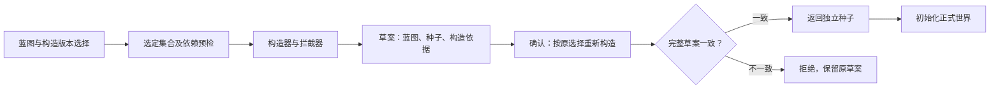

# 构造版本与草案确认小闭环

> 发布阅读说明：下文的本地历史报告位于忽略的 build 或 runs 目录，不随源码仓库上传。它们记录开发时的验证范围；运行对应脚本会生成你自己的新目录和报告。本轮复核见[开发版验证记录](RELEASE-CHECKS.md)。

日期：2026-10-11。范围：构造器版本选择、依赖与资料检查、旧草案兼容、完整确认和确认后的既有行动。

## 结论

本轮已经实际通过 **16组独立 Java 检查、24项实际命令行检查**。同标识的两个构造实现可以并存，并产生不同资料；旧蓝图固定选版本1，新蓝图明确选择版本。缺少精准实现或草案重建不一致时停止，原草案不改写，也不建立正式世界。

构造器处理作者明确提供的结构化资料。这个闭环检验构造与确认边界，尚未调用模型创造世界，也未检验小说质量。

## 架构怎样协作



| 责任 | 已实现的合同 |
|---|---|
| 注册 | 按 `id + version` 区分实现，冻结 `id/version/sectionName/dependencies`；同一组合不能覆盖。 |
| 选择 | 显式列表中同标识只选一版。缺省管线为宿主每个已注册标识固定选版本1，不选最新、不回退。 |
| 预检 | 仅检查选中集合的资料名称与依赖。精准版本、依赖、循环或资料冲突失败时，构造与拦截回调尚未执行。 |
| 构造 | 每个构造与拦截回调前后核对全部已选合同。上下文是独立副本，贡献经受控合并与世界内核检查。 |
| 记录 | 显式草案的模块行保存版本、资料名称、排序依赖；依据行保存模块版本。旧草案维持原形状。 |
| 确认 | `confirmSeed` 严格检查草案，再重建原蓝图并比较完整规范化内容。只有一致才返回 seed 深拷贝，本方法无文件写入。 |
| 正式起点 | CLI 把确认后的 seed 交给 `WorldStore.initialize`，建立零事件世界。正式存档保存 seed；构造依据仍在草案文件中。 |

`sections.world` 仍必填，选中集合必须有处理 world 资料的构造器，标识可以是 `base` 等其他名称。其他已有资料也必须由本次选定处理器支持，不能静默略过。

旧缺省蓝图会包含宿主的每个已注册标识；新增标识可能改变完整草案，此时确认明确拒绝。显式列表可以固定集合。版本号不证明同版本源码未变：如果同版实现产生不同结果，完整确认也会拒绝。

## 直接运行

```powershell
# 请先进入下载或克隆后的项目根目录
.\run.ps1 -ConstructorVersionCheck
.\verify-constructor-version-cli.ps1

.\run.ps1 construct .\examples\genesis-river-town-versioned.json .\runs\explicit-river-draft-v1.json
.\run.ps1 confirm .\runs\explicit-river-draft-v1.json .\runs\explicit-river-world-v1.json
.\run.ps1 step .\runs\explicit-river-world-v1.json ask .\examples\genesis-ask.json
.\run.ps1 step .\runs\explicit-river-world-v1.json travel .\examples\genesis-travel.json
.\run.ps1 history .\runs\explicit-river-world-v1.json
```

输出文件需使用新名称。示例中阿禾向陈舟询问铁料位置，再沿既有通路到达货栈，产生两条正式事件。它没有把到达写成现场观察、领取或运回铁料。

完整示例固定八类构造器为版本1。以下只是蓝图的可选选择字段片段：

```json
"constructors": [
  {"id":"world","version":"1"},
  {"id":"person","version":"1"},
  {"id":"faction","version":"1"},
  {"id":"group","version":"1"},
  {"id":"extra","version":"1"},
  {"id":"relationship","version":"1"},
  {"id":"emotion","version":"1"},
  {"id":"law","version":"1"}
]
```

版本须为非空、不含换行的文本；显式 null、数字、空白均拒绝。依赖目前指向构造器标识，通过所选集合中的版本解析；依赖成立不等同于不同版本的语义兼容。

## 实际证据

以下案例保留首次保存的输出。生产最终修正后的当前结果另见十四套验收汇总（本地历史文件：`build/constructor-version-acceptance.json`）、本轮构造命令行报告（本地历史文件：`runs/constructor-version-cli-e373161998cf46298863c842cb50d5c1/constructor-version-cli-check.json`）与[验收记录](ACCEPTANCE.md)，原始案例目录不替换。

- 16组 Java 专项（本地历史文件：`build/constructor-version-check.json`）：真实版本1与2产生不同位置事实；固定默认版本；未选实现隔离；依赖错误零回调；身份漂移；快照；同版产物变化；严格确认。
- 24项命令行专项（本地历史文件：`runs/constructor-version-cli-9538f188e45e4d998571fa86272dc0ea/constructor-version-cli-check.json`）：保存新旧草案，启动独立进程确认、拒绝篡改和继续行动。
- [改版前保存的旧草案](examples/legacy-river-draft.json)：逐字复制自此前构造命令行验收的草案，保持原格式；本轮实际确认且文件字节不变。
- [显式版本蓝图](examples/genesis-river-town-versioned.json)与实际显式草案（本地历史文件：`runs/constructor-version-cli-9538f188e45e4d998571fa86272dc0ea/explicit-draft.json`）。
- 确认后的连续历史（本地历史文件：`runs/constructor-version-cli-9538f188e45e4d998571fa86272dc0ea/final-history.json`）：询问和移动各一条，重试移动没有新事件。
- [受影响回归与统一验收](ACCEPTANCE.md)：每套原始报告分别保存，数量不代表互不重叠的能力。

## 未确认项与维护要求

- CLI 目前只注册内置构造版本1。自定义两个版本由 Java 宿主注册，没有外部插件热加载器。
- 版本号不是代码签名；扩展是可信本地 Java 代码，没有恶意扩展隔离。同版语义不得随意变更。
- 确认会重新运行选定构造器与拦截器，扩展应保持确定的资料转换；这里没有“只调用一次”保证。
- 新程序兼容缺省旧蓝图与旧草案，不保证旧程序读取新显式选择字段及新增元数据。
- 正式世界没有复制构造元数据，追溯构造时需要保留原草案；当前没有完整来源签名或跨内核语义兼容保证。
- 当前文件原子替换未做断电耐久验证；模型、自动世界生成、人物心理和小说风格约束尚未实现。

后续沿最小经历检查世界与人物所需依据，再检验人物选择和事件传播；共同的身份、空间、时间和历史约束继续由内核负责。
