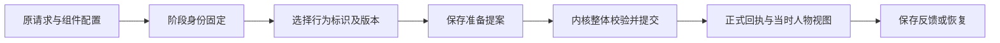

# 行为版本与旧过程恢复小闭环

> 发布阅读说明：下文的本地历史报告位于忽略的 build 或 runs 目录，不随源码仓库上传。它们记录开发时的验证范围；运行对应脚本会生成你自己的新目录和报告。本轮复核见[开发版验证记录](RELEASE-CHECKS.md)。

日期：2026-10-11。本轮补齐“换实现后，既有世界与既有尝试如何继续”的边界。使用独立 Java 项目、本地结构化策略和命令行；未调用模型。

## 实际结果

同一个行为标识可以注册版本1与版本2，新请求明确选择版本。旧记录未写版本时仍解释为版本1，比较过程中只规范化副本，正式历史不补写。已经完成的请求返回原回执，不调用其他版本。

独立 Java 专项实际通过19组，包含两个版本的真实回调计数、保存提案后更换宿主、身份漂移与失败恢复。命令行实际通过15项，保留旧入口与新显式入口的结果、世界文件、演绎阶段、拒绝输入和错误输出。全部受影响回归结果见[验收记录](ACCEPTANCE.md)。

## 运行链与责任



| 当前恢复点 | 引擎的实际处理 |
|---|---|
| 已有正式事件 | 先核对完整行为输入和版本，返回原回执，读取原事件版本的视图。 |
| 已保存准备提案，尚未提交 | 使用保存的提案，不重新调用行为实现；同一内核检查身份、世界版本、权限和全部效果。 |
| 尚无准备提案，需要推导 | 必须找到指定标识与版本；缺实现就明确失败，不能改用别的版本。 |
| 演绎阶段已完成 | 配置中的组件仍须能注册并查找到绑定；验证阶段产物及保存身份后直接复用，不重新运行该阶段。 |
| 演绎阶段未完成 | 运行配置中固定的实现，回调前后核对标识、版本、阶段；失败记录仍使用原声明身份。 |

五阶段组件的版本和行动模块的版本是两层合同。例如，版本1的行动转换组件可以选择版本2的询问行为，产物必须把这个选择一路保留。完整演绎输入仍须与旧请求相同；不能修改旧请求中的版本再冒领原尝试。

## 独立运行

```powershell
# 请先进入下载或克隆后的项目根目录
.\run.ps1 -ModuleVersionCheck
.\verify-module-version-cli.ps1
```

第一条检查通过 Java 宿主注册同名的两个行为版本，证明版本2实际执行、版本1的旧提案在只注册版本2的新宿主中恢复时不会调用版本2。第二条启动多个真实命令行进程，验证内置版本1和缺失版本的拒绝。命令行目前没有外部插件加载器，因此它不负责装入任意版本2实现。

### 显式版本1的一次询问

使用新文件名，避免覆盖既有世界。

```powershell
.\run.ps1 construct .\examples\genesis-river-town.json .\runs\version-draft-v1.json
.\run.ps1 confirm .\runs\version-draft-v1.json .\runs\version-world-v1.json
.\run.ps1 experience .\runs\version-world-v1.json .\examples\experience-ask-versioned.json .\runs\version-ask-v1.json
.\run.ps1 experience .\runs\version-world-v1.json .\examples\experience-ask-versioned.json .\runs\version-ask-v1.json
.\run.ps1 history .\runs\version-world-v1.json
```

第一遍询问保存五个阶段、版本1的准备提案和一个正式事件；第二遍返回原结果。阿禾从陈舟得到有来源的位置消息，自己仍在码头，不表示已经现场观察或完成运输。候选里新增的字段是：

```json
{"module": "ask", "moduleVersion": "1"}
```

这是候选中的两项字段，完整例子见[显式版本询问输入](examples/experience-ask-versioned.json)。省略字段固定为版本1；显式 null、数字、空白或换行都会拒绝。

### 直接行动入口

```powershell
.\run.ps1 confirm .\runs\version-draft-v1.json .\runs\version-direct-world-v1.json
.\run.ps1 step .\runs\version-direct-world-v1.json ask .\examples\genesis-ask.json 1
.\run.ps1 step .\runs\version-direct-world-v1.json ask .\examples\genesis-ask.json
.\run.ps1 history .\runs\version-direct-world-v1.json
```

最后一个参数可选。这里使用另一份新的正式世界：先明确执行版本1，再用旧入口重读相同请求，仍只有一个事件。没有参数固定版本1，新提交使用旧格式；显式参数写入 `submission.moduleVersion`。两种入口可以返回同一回执，但不会改变原事件的格式。

## 可回查的证据

- 19组版本专项报告（本地历史文件：`build/module-version-check.json`）：报告内记录独立目录，包含两个版本、受控未提交窗口与身份漂移反例。
- 15项实际命令行报告（本地历史文件：`runs/module-version-cli-8c384f846fe84fcf9572dd0380fc109c/module-version-cli-check.json`）。
- 旧事件与新显式事件并存的历史（本地历史文件：`runs/module-version-cli-8c384f846fe84fcf9572dd0380fc109c/final-history.json`）。
- 新事件之后恢复的旧演绎（本地历史文件：`runs/module-version-cli-8c384f846fe84fcf9572dd0380fc109c/old-experience-recovered.json`）：回执及反馈视图仍为原事件版本。
- 缺失行为版本的失败记录（本地历史文件：`runs/module-version-cli-8c384f846fe84fcf9572dd0380fc109c/two-record.json`）：四个阶段完成，准备行为时失败，没有正式回执。

## 已修正的问题与证据限制

交叉审查发现，演绎组件原来可以在回调中改变自身版本，并把错误身份写入阶段记录。现在注册时捕获身份，回调前后核对，成功与失败记录都使用捕获值；反馈实现已漂移时，在准备和提交世界前拒绝。19组专项中新增四组覆盖这些边界，并证明合法同版实现能恢复失败记录。

保存提案后的恢复试验使用受控的未提交记录，不能当成断电试验。版本字段也不提供代码签名或恶意插件隔离；同版本实现不得变更语义，需要维护纪律和回归。新程序读取旧记录，不保证旧程序能读取新增显式版本字段。后续构造版本改版见[构造版本与草案确认](CONSTRUCTOR-VERSION-DEMO.md)，采用独立专项核对；跨内核版本的效果解释仍需要另行验收。

维护边界见[内核维护约定](KERNEL-MAINTENANCE.md)，精确格式见[输入协议](PROTOCOL.md)，经典架构借鉴与真实缺口见[架构对照](ARCHITECTURE-REFERENCES.md)。
