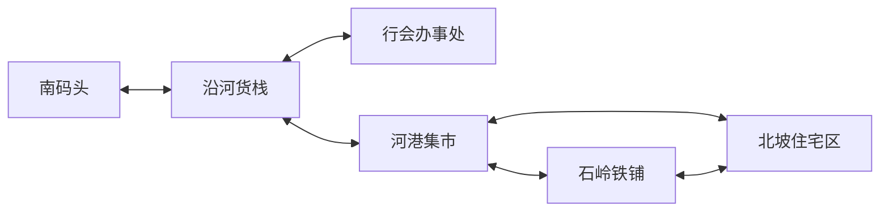
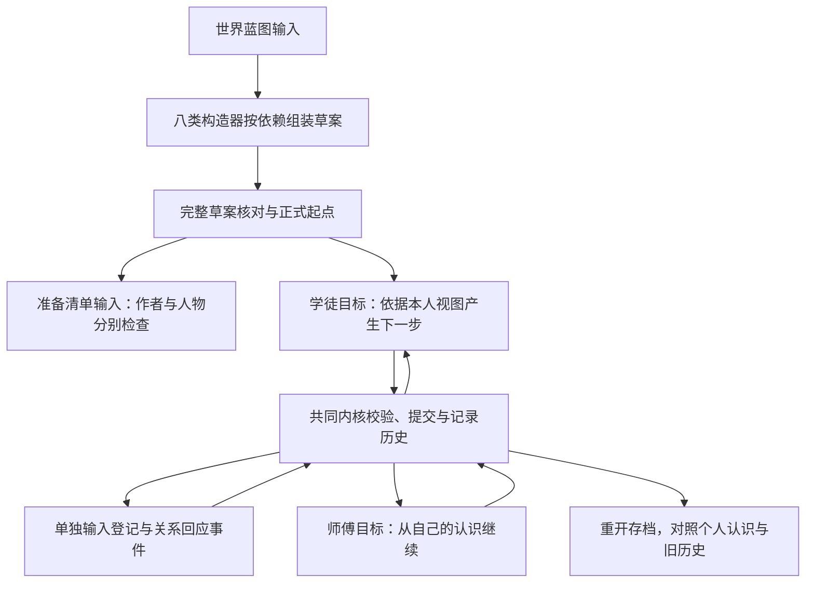

# 河港镇：一个可以运行的基础小世界

> 发布阅读说明：下文的本地历史报告位于忽略的 build 或 runs 目录，不随源码仓库上传。它们记录开发时的验证范围；运行对应脚本会生成你自己的新目录和报告。本轮复核见[开发版验证记录](RELEASE-CHECKS.md)。

## 本次选择的目标

先建立**有地理、有生活、有制度、有不同人物立场的河港镇**，再让两个人凭各自的消息与路线参与同一次货物交接。核实、登记与许可分别处理；每一步发生后留下世界历史与个人认识。

本次选择经营底色和轻悬疑：铁匠等料开工，商人等农具交货，船工等结算，货栈怕误放货，登记员发现编号不同。题材影响这份素材的冲突与目标，目前尚无自动执行的题材证据规则或风格生成器。

这是人工设计世界与目标、程序运行明确规则的试验。世界蓝图和登记回应由示例设计者提供；询问对象、路线下一跳、观察和停止由目标组件根据本人视图产生。

## 世界为什么会在这里

河湾旧渡口与粮仓连接水运和内陆道路。驻军离开后，船工、保管货物的人、修造农具的作坊留下，往来的粮船与商队使街市连成镇。货栈赚保管费，行会靠登记和可靠交接维持生意，铁铺靠订单与订金周转，集市把粮食和农具接到沿河村落。

这些是本次原创设定，保存于蓝图，不声称再现某个真实朝代。镇子的生活依据借鉴河运社区的产业联系，来源列在文末。

### 地点与通路



这是依据蓝图整理的通路图，不是精确比例地图。六组双向联系在输入中保存为十二条有向边；人物只有获知相应路线，才能据此选择下一跳。背景文字描述河湾、高地与地区生活；内核本次约束的是地点身份、固定事实和明确通路，不计算距离、水文或行程小时。

### 各个人物为什么会牵涉进来

| 人物 | 已建立的处境与目标 | 本次运行范围 |
|---|---|---|
| 阿禾，铁铺学徒 | 受师傅委托查明铁料位置与交接状态，担心再听岔差事。 | 从码头询问、抵达货栈、直接观察状态。 |
| 林桂，铁匠 | 六套农具的订单等料开工，怕延误收入和熟客信任。 | 从铁铺沿本人路线到货栈，取得自己的现场认识。 |
| 陈舟，船工 | 已经把铁料交入货栈，想结算这趟工钱；知道入栈，不知道后续登记状态。 | 提供本人有来源的位置消息；家事保留在私有资料。 |
| 沈砚，货栈保管员 | 怕口头放货后担责，也不想无故占着铁铺的料。 | 示例后续事件登记本栈交接并留下关系回应；不是自主心理推导。 |
| 许瑶，行会登记员 | 发现副本与随货签编号不同，想有依据地改错。 | 建立处境、关系和疑点，本轮没有运行她的核对过程。 |
| 邵宁，商人 | 已付农具订金，需要向村民交代；愿协调，也不能无限担保。 | 建立订单联系和私有顾虑，本轮没有自动买卖。 |

陈舟由龙套构造器展开，但已具备本次重要交接职责。群体仍记录其余未展开成员，不把所有人都建立成同样详细的个体。

### 这版基本结构

| 基本结构 | 实际输入 |
|---|---|
| 地理与地区来由 | 六地点、十二条有向边、一处地区，固定地理与形成历史。 |
| 生活与资源 | 铁料、木炭、粮袋三类资源，数量引用正式事实；有订单与保管费的生活联系。 |
| 制度与利益 | 河港行会、集市商户联合两类势力；年92交接争执解释登记制度来由。 |
| 群体 | 船工搬运工十二人、登记货栈员工六人；仅展开本次相关人物。 |
| 人物与关系 | 五名人物构造器角色加一名龙套，共六人；九条带依据的定向关系，六份私有初始感受。 |
| 世界法则 | 十条声明法则约束资源非负、人数和允许状态；通路、身份、时间和历史由共同内核约束。 |
| 信息差与未决项 | 各人物分开保存知识；编号疑点、领取许可和运送量没有被补成成功。 |

初始感受、生活联系和制度文字能为后续创作提供材料，尚不会自动变成心理计算、经济循环或执法机制。

## 输入输出怎样接在一起



两份目标请求没有人工动作序列。现有组件只解释“到已知地点核实某个事实”这种明确目标；它们不会从全部性格资料自行规划一生。登记回应另有输入，并明确是作者事件。三种来源在存档与验收中分开保留。

## 运行与证据

```powershell
# 请先进入下载或克隆后的项目根目录
.\verify-small-world-cli.ps1
```

这一条命令会编译当前独立引擎，在新的运行目录生成草案和正式世界，接着执行两个人的核实过程与明确提供的登记回应。每次新建目录，原世界和五份源输入保持原样。控制台只显示结果概要，完整报告与逐步输入输出保存在运行目录。

默认的一条运行命令已经实际通过：包含编译和53次独立 Java 命令行调用。外层进程退出码0，报告无失败；其中两次非零退出是预期拒绝非法资源值和非法登记状态，均核对存档不变。348个断言包括编译、逐人物、逐路线和逐事实核对，有重复覆盖，不能理解为348种能力。

| 正式版本 | 实际事件 | 世界或个人认识的变化 |
|---|---|---|
| 0 | 确认起点 | 阿禾在码头，林桂在铁铺；货物在货栈，尚待登记。 |
| 1 | 阿禾询问陈舟 | 获得来源为陈舟的位置消息，没有获得交接状态。 |
| 2 | 阿禾到货栈 | 依本人已知通路移动，未自动观察所有事实。 |
| 3 | 阿禾现场观察 | 本人直接知道“暂扣，等待登记”；目标满足后停止。 |
| 4 | 作者提供登记与关系回应 | 登记完成，交接等待许可；保管员取得新认识，阿禾和登记员原认识保留。 |
| 5 | 林桂到集市 | 从铁铺沿本人已知通路移动。 |
| 6 | 林桂到货栈 | 继续下一跳，不虚构铁铺直达货栈。 |
| 7 | 林桂现场观察 | 本人直接知道“已登记，等待许可”；目标满足后停止。 |

重新打开后，两人仍在货栈，阿禾保留版本3的认识，林桂持有版本7的认识。每条完成过程重新运行均复用原记录，没有追加行动。准备报告提示作者看到的认识冲突，以及人物仍需重新核实；不从作者视图替人物更新。

本次原始证据：

- 完整运行报告（本地历史文件：`runs/small-world-cli-886a7b337c2f417584c078c0dfb4c893/small-world-cli-check.json`）：每次命令、退出码、输入输出、实际断言与源输入校验。
- 正式事件历史（本地历史文件：`runs/small-world-cli-886a7b337c2f417584c078c0dfb4c893/final-history.stdout.json`）：七笔事件，两条目标过程的停止记录没有当成正式事件。
- 阿禾重开后的认识（本地历史文件：`runs/small-world-cli-886a7b337c2f417584c078c0dfb4c893/reopened-apprentice.stdout.json`）与林桂重开后的认识（本地历史文件：`runs/small-world-cli-886a7b337c2f417584c078c0dfb4c893/reopened-smith.stdout.json`）：同一世界，不同人物的知识来源与取得版本。
- 最终准备报告（本地历史文件：`runs/small-world-cli-886a7b337c2f417584c078c0dfb4c893/reopened-preparation.stdout.json`）：许可未满足、运送量缺失，旧观察需要核实。
- [五份世界输入](examples/small-world/genesis.json)：世界蓝图；同目录另有两份目标、准备清单与登记回应输入。

**本次架构结果：**新增世界数据和命令行组合即可复用八类构造器、目标组件、准备分析和同一正式提交内核。没有为河港镇新增专用效果或在内核写人物分支。由这一例可以验证组合边界，尚不能推定所有题材或长期规模都已成立。

## 尚需补充的能力

本次达到的目标是基础结构相互关联、核实经历能持续保存。后续仍需以独立小闭环验证：人物反应自动产生后果、更多目标类型、信息传播、活动调度、资源加工、按需新增目录，以及小说风格与正文效果。

后续一轮已补上[人物收到消息后的回应](MESSAGE-REACTION-DEMO.md)：在独立的新存档里，保管员依据本人收到的消息和明确策略分享条件，并留下单向关系变化。它与本页的七事件登记案例分开；本页原输入和原始证据继续保留。

领取许可仍未授予，运送量仍未知，登记副本的编号疑点也未解决。它们是后续故事的入口，不能从一次现场观察直接变成货物送达。

## 参考资料与采用范围

- **生活联系：** 美国国家公园局记载运河运输带动修船、粮饲补给和周边产业。我们据此选择码头、货栈、作坊、集市与住宅相互需要的设定，没有移植准确运价和产能。[NPS：Canal Operation](https://www.nps.gov/choh/learn/historyculture/canaloperation.htm)
- **行动依据：** Riedl 与 Young 研究因果推进和人物意图的可理解性。我们采用“各自目标能解释行动，真实后果影响后续”的检查方向，未实现整套 IPOCL 算法，也不由此保证文学质量。[原始论文：Narrative Planning: Balancing Plot and Character](https://arxiv.org/abs/1401.3841)
- **按需展开：** Epic 的关卡流送将持久主关卡与按需加载的区域分开。这给后续扩展提供设计启发；当前没有场景流送器，持久事实、共同时间和个人信息范围由自己的内核负责。[Epic：Level Streaming Overview](https://dev.epicgames.com/documentation/en-us/unreal-engine/level-streaming-overview?application_version=4.27)
